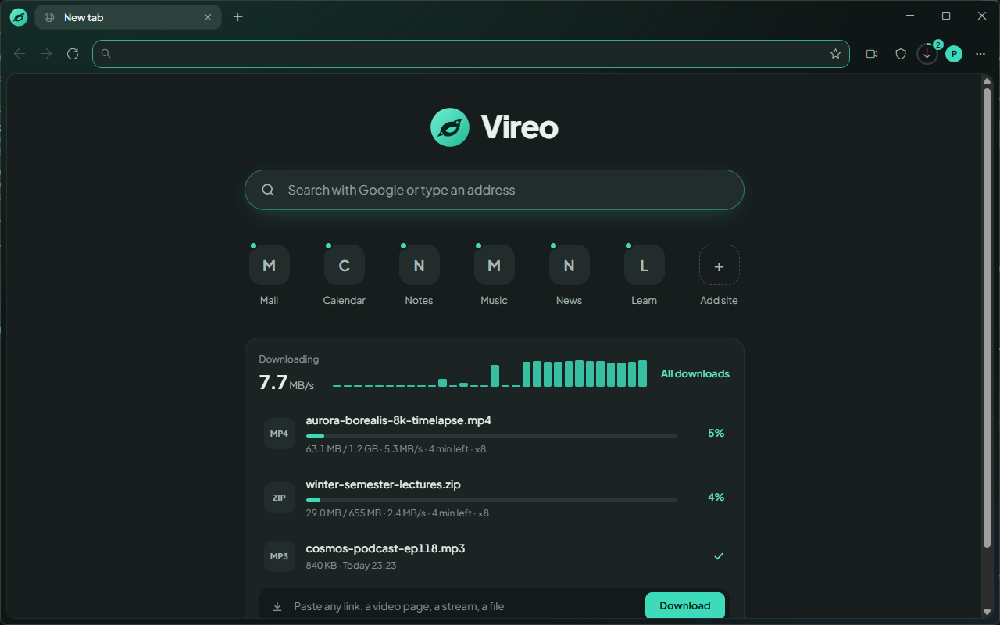
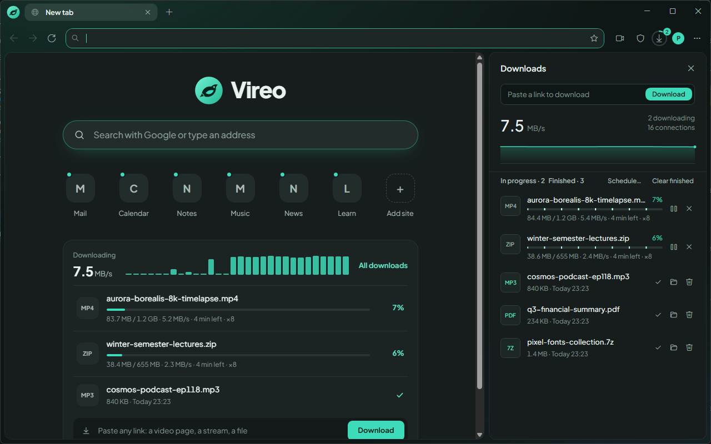
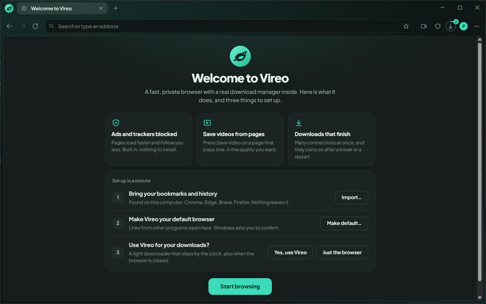
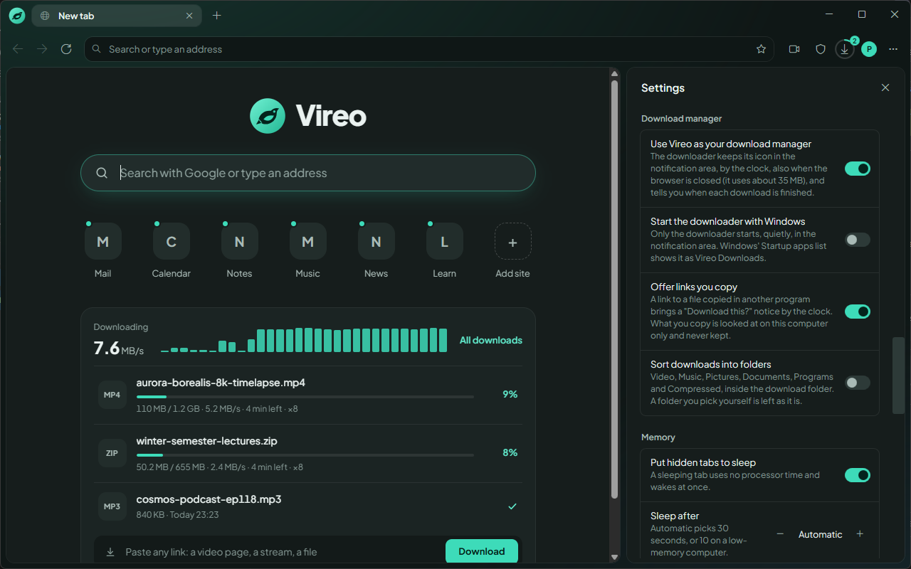
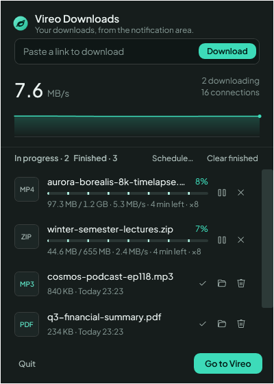

<div align="center">
  
  <h1>Vireo</h1>
  <p><b>A fast, private browser for Windows, with no ads, no pop-ups, and one-click saving of the videos and files you watch.</b></p>
  <p>
    
    
    
  </p>
  <p>
    <a href="https://github.com/refora-technologies/vireo/releases/latest">Download</a> &nbsp;·&nbsp;
    <a href="docs/FEATURES.md">Features in detail</a> &nbsp;·&nbsp;
    <a href="PRIVACY.md">Privacy</a> &nbsp;·&nbsp;
    <a href="https://github.com/refora-technologies/vireo/issues">Report a problem</a>
  </p>
</div>

<br/>

## Overview

**Vireo** by Refora Technologies is a browser for people who want the web clean, quick and private. Ads, trackers and
pop-ups are stopped before they load. The video or song a page is playing gets a **Download** button with every quality the
site offers. Hidden tabs fall asleep so even a laptop with 4 GB of memory stays responsive. There is nothing to add: the
things other browsers leave to extensions are built in.

Pages are shown by Microsoft's WebView2 engine (the Chromium engine that is part of Windows), so sites work as they do in
Chrome and Edge. Everything around the page, from the tabs to the download manager, is Vireo's own.

## Screenshots

<p align="center">
  
  <br><sub>The start page: your own sites, the live download speed and what is coming down.</sub>
</p>

<table>
  <tr>
    <td width="50%"></td>
    <td width="50%"></td>
  </tr>
  <tr>
    <td><sub><b>Downloads</b>: several connections per file, a minute of speed history, pause and resume, schedule.</sub></td>
    <td><sub><b>Welcome</b>: bring your bookmarks, make Vireo the default browser, use it for downloads.</sub></td>
  </tr>
  <tr>
    <td></td>
    <td align="center"></td>
  </tr>
  <tr>
    <td><sub><b>Download manager</b>: stays by the clock, starts with Windows, offers links you copy, sorts files.</sub></td>
    <td><sub><b>The downloader alone</b>: keeps going when the browser is closed, using very little memory.</sub></td>
  </tr>
</table>

## Key features

- **Clean pages:** ads and trackers are blocked before they load, with EasyList, EasyPrivacy, Peter Lowe's and AdGuard's
  lists, video ads included. Pop-up windows and surprise new tabs are stopped. Turn blocking off for one site in two
  clicks if it misbehaves.
- **Save what you watch:** a Download button sits on every video and audio player, listing its qualities. Vireo
  understands plain files, HLS and DASH streams, live streams (recorded until you stop) and videos whose picture and
  sound come separately, which it joins into one MP4 itself, with no outside tools. Protected (DRM) content is recognised
  and never downloaded.
- **A real download manager:** big files come down over several connections at once, survive a dropped connection or a
  restart, and can be queued and speed-limited. It can also live by the clock on its own (about 10 MB), start with
  Windows, offer links you copy, sort files into folders, check checksums, and sleep or shut down the computer when done.
- **Private by default:** clean links (tracking tags removed), secure connections preferred, your network address hidden
  from video-call scripts, and private windows that leave nothing behind but the files you choose to keep.
- **Light on memory:** hidden tabs are frozen, then freed, and wake with their page when you return. Made for low-end
  laptops as much as for fast desktops.
- **Your way:** tabs on any side, pinned sites on the start page, separate profiles for work and home, and sync through a
  folder in your own cloud storage, encrypted with your passphrase.
- **Keeps itself current:** updates download in the background, are checked against a published checksum, and install
  when you close Vireo. No administrator prompts.

Everything, in detail: [docs/FEATURES.md](docs/FEATURES.md).

## Installation

**Requirements:** 64-bit Windows 10 (version 1809 or later) or Windows 11.

1. Download `VireoSetup.exe` from the [latest release](https://github.com/refora-technologies/vireo/releases/latest).
2. Run it. Vireo installs for your account only and needs no administrator rights. If your computer does not have
   Microsoft's WebView2 engine yet, setup fetches it for you.
3. Vireo opens when setup finishes. To make it your default browser, open Windows Settings → Apps → Default apps.

Each release lists the installer's SHA-256 in `VireoSetup.exe.sha256`; to check it yourself:
`Get-FileHash .\VireoSetup.exe -Algorithm SHA256`.

> **About antivirus warnings.** Vireo is not code-signed yet, and a new unsigned program that downloads files can be
> flagged by some antivirus products' behaviour monitors. Vireo only downloads what you ask it to, reads no other program's
> data, and its full source is here to inspect. If your antivirus flags it, please tell us in an issue.

## Using Vireo responsibly

Vireo saves what your browser is already playing, for offline viewing. Only download what you have the right to: your
own content, content under a licence that allows it, or what the site's terms permit. Vireo never breaks copy protection.
See [TERMS.md](TERMS.md).

## Technical stack

- **Framework:** .NET 10 (WPF), self-contained
- **Web engine:** Microsoft Edge WebView2 (Chromium)
- **Media:** Vireo's own HLS and DASH readers, MP4 joiner and MPEG-TS converter (no ffmpeg needed)
- **Blocking:** Vireo's own filter engine for the Adblock Plus list format
- **Installer:** Inno Setup 6

## Building from source

```
dotnet build src/Vireo -c Release
dotnet test tests/Vireo.Tests
powershell -ExecutionPolicy Bypass -File build.ps1    # the installer, in out\installer
```

You need the .NET 10 SDK, and Inno Setup 6 for the installer. [docs/DEVELOPMENT.md](docs/DEVELOPMENT.md) has the rest:
the browser self-test, the local test server and how releases are made.

## Contributing

Bug reports, testing and pull requests are welcome; see [CONTRIBUTING.md](CONTRIBUTING.md). To report a security problem,
please follow [SECURITY.md](SECURITY.md) instead of opening an issue.

## License

Vireo is free software, released under the [GNU General Public License v3.0](LICENSE).
Copyright © 2026 Refora Technologies. Third-party components and their licences are listed in
[THIRD-PARTY-NOTICES.txt](THIRD-PARTY-NOTICES.txt).
